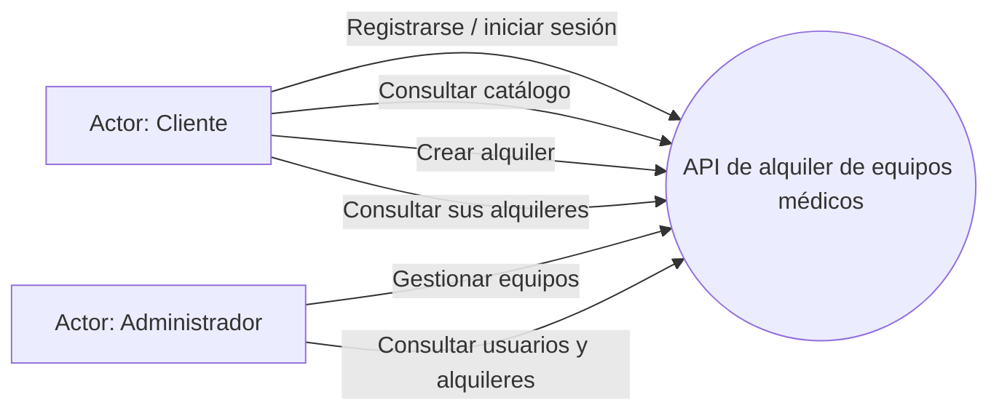
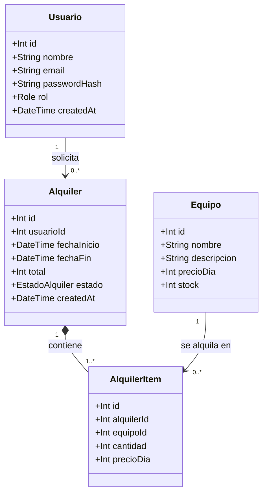
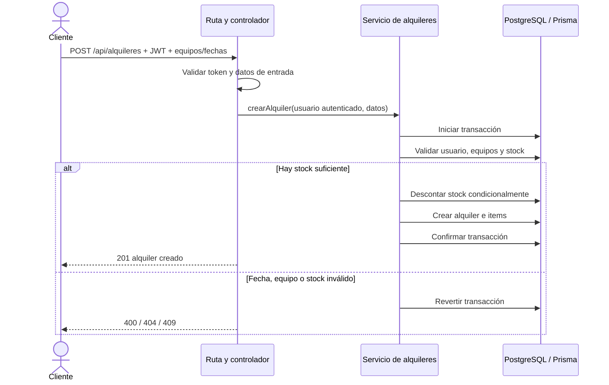

# Hito 1 — Dominio y modelado

## Equipo y dominio

- **Dominio elegido:** alquiler de equipos médicos.
- **Integrante reportado:** Juan Correa (trabajo individual actualmente). La guía del ABP indica equipos de 2 a 3 personas; confirmar con el profesor si esta modalidad individual está autorizada antes de presentar el hito.
- **Proceso principal:** un cliente autenticado solicita uno o más equipos para un rango de fechas. El sistema valida el usuario, las fechas, la existencia y el stock; si hay disponibilidad, registra el alquiler y descuenta el inventario. Si no, rechaza la operación sin modificar la base.

## Casos de uso

## Diagrama de clases del dominio

`AlquilerItem` resuelve la relación muchos-a-muchos entre alquileres y equipos y conserva el precio diario aplicado al momento de la solicitud.

## Diagrama de secuencia de la operación principal

## Proceso BPMN

El archivo [`proceso-alquiler.bpmn`](./proceso-alquiler.bpmn) describe el proceso con eventos, tareas, compuerta de disponibilidad y salidas de éxito o conflicto.
